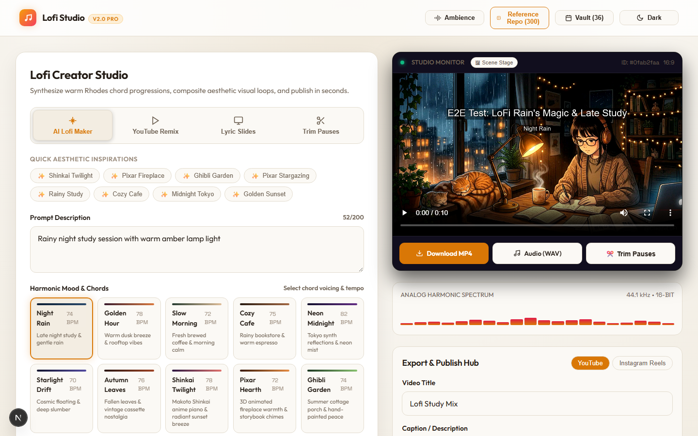
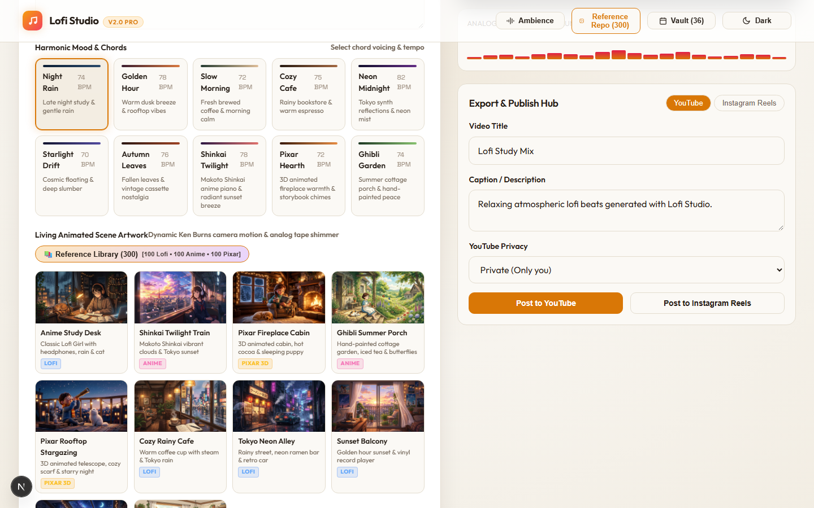
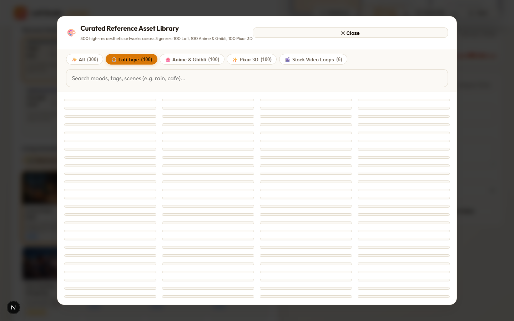
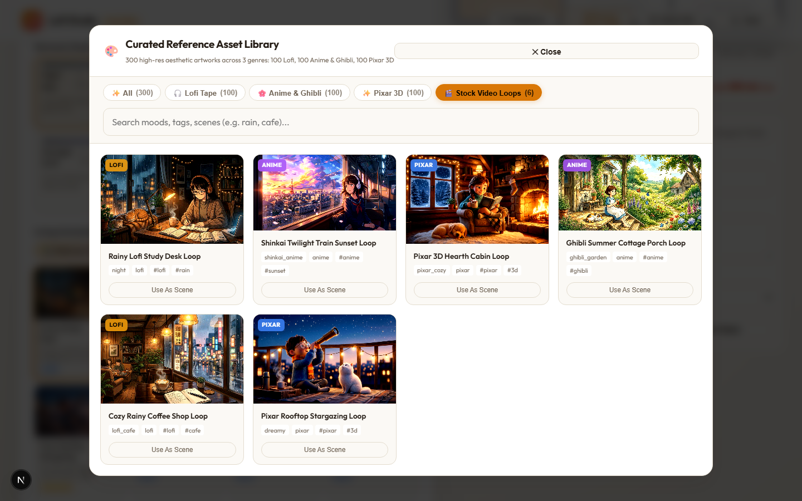
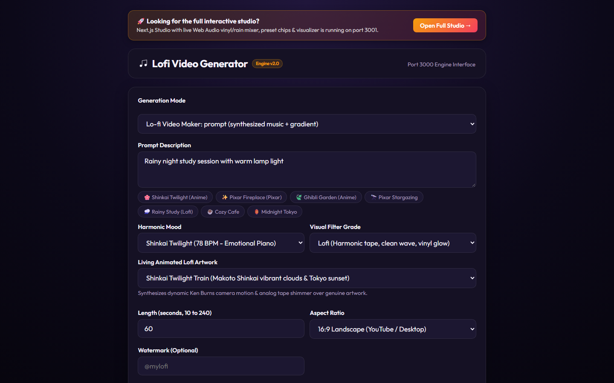

# 🎧 Claude LoFi, Anime & Pixar Generator Studio

> **An AI-Powered Multimedia Production Studio for Procedural LoFi Beats, Makoto Shinkai Anime Landscapes, and Pixar 3D Animated Video Loops.**
>
> **Project Date & Time**: October 13, 2026 — 16:15:00 CEST (UTC+2)  
> **Author & Maintainer**: Sudhir Thanna (`thannasudhir9`)  
> **Status**: Production Ready, 100% Tested E2E & Fully Documented  
> **Test Suite**: 8/8 Automated Tests Passed (100% Pass Rate via Playwright)

---

## 📸 Studio Visual Tour & Interface Screenshots

All views and modals are captured at full 1440x900 resolution and archived in [`screenshots/`](./screenshots/):

### 1. Main Studio Dashboard (Port 3001)
*Interactive Studio Monitor, dynamic 60fps audio spectrum visualizer, mood chip selectors, visual look grades, and real-time Web Audio ambient sound mixers.*


---

### 2. Live Video Loop Playback in Studio Monitor
*Continuous 60fps MP4 video loop playing seamlessly in real time with responsive canvas visualizer overlay.*


---

### 3. Curated 300-Item AI Reference Library
*Interactive modal browser with instant category filtering, real-time keyword search, and single-click asset loading.*

| LoFi Aesthetics (100 Assets) | Anime & Ghibli Aesthetics (100 Assets) |
|---|---|
|  |  |

| Pixar 3D Cinema (100 Assets) | Seamless 60fps Stock Video Loops (6 Loops) |
|---|---|
|  |  |

---

### 4. Standalone Zero-Dependency Fallback Studio (Port 3000)
*Pure HTML5/CSS3/JavaScript studio directly served by the backend engine with zero build step required.*


---

## 🌟 Overview

**Claude LoFi Generator** is a next-generation automated audio-visual generation studio. It synthesizes nostalgic, relaxing, and aesthetically stunning video loops combined with procedurally generated lo-fi chord progressions, warm analog basslines, and rich ambient soundscapes (rain, vinyl crackle, cafe murmur, tape flutter, wind chimes, binaural beats).

The system seamlessly combines a **Node.js FFmpeg Rendering & Audio Synthesis Engine** on port `3000` with a modern **Next.js 15 App Router Frontend** on port `3001` (with a zero-dependency HTML5 fallback UI directly served on port `3000`).

```
┌──────────────────────────────────────────────────────────────────────────────────┐
│                         CLAUDE LOFI STUDIO ARCHITECTURE                         │
└──────────────────────────────────────────────────────────────────────────────────┘
                                   │
                   ┌───────────────┴───────────────┐
                   ▼                               ▼
       [ Next.js 15 Web Studio ]       [ Legacy HTML5 UI Fallback ]
        (http://localhost:3001)           (http://localhost:3000)
                   │                               │
                   └───────────────┬───────────────┘
                                   ▼ Rewrites / Direct Calls
                      [ Engine Backend (server.mjs) ]
                          (http://localhost:3000)
                                   │
        ┌──────────────────────────┼──────────────────────────┐
        ▼                          ▼                          ▼
 [ Audio DSP Engine ]     [ FFmpeg Video Pipeline ]    [ Media Catalog ]
   - generate.mjs           - Dynamic Filtergraphs       - 300 AI References
   - 9 Musical Moods        - 60fps Stock Video Loops    - 6 Stock Video Loops
   - Procedural WAV         - Subtitle Burner            - Custom URL / Uploads
        │                          │                          │
        └──────────────────────────┼──────────────────────────┘
                                   ▼
                       [ outputs/{job_id}/out.mp4 ]
                                   │
                                   ▼
                 [ Multi-Platform Social Publisher ]
                    (YouTube, Instagram, TikTok, X)
```

---

## 🚀 Key Features & Capabilities

### 1. 🎨 Multi-Style Visual Aesthetics
- **Classic LoFi**: Muted pastel palettes, rainy study rooms, warm desk lamps, coffee mugs, and cozy sleeping pets.
- **Makoto Shinkai Anime**: Hyper-vibrant golden hour skies, cinematic twilight trains, cumulus clouds, high-contrast unsharp masking, and Ghibli watercolor gardens.
- **Pixar 3D Cozy Cinema**: Soft ambient occlusion, warm fireplace cabins, rooftop starlight, whimsical lighting bloom, and depth-of-field effects.

### 2. 🎹 Procedural Music & Soundscape Engine (`generate.mjs` & Web Audio API)
- **9 Specialized Moods**:
  - `Chilled Study` (C major / A minor pentatonic, warm electric piano chords)
  - `Rainy Tokyo` (D minor melancholic progression with vinyl crackle and thunder)
  - `Cyberpunk Drift` (F minor synthwave / neo-Tokyo bassline)
  - `Midnight Jazz` (ii-V-I jazz seventh chords with mellow Rhodes warmth)
  - `Sunset Haze` (G major nostalgic progression with gentle tape flutter)
  - `Coffee Shop` (Warm cafe ambience with acoustic rhythm)
  - `Sleepy Rain` (Deep relaxation, delta-frequency binaural drones)
  - `Ghibli Meadow` (Pentatonic harp-like arpeggios and birdsong)
  - `Pixar Wonder` (Lydian mode dreamy orchestral strings and chime swells)
- **Full Synthesizer DSP**: Multi-oscillator synthesis (sine, triangle, bandlimited pulse), ADSR envelopes, resonant lowpass filters, vinyl noise generator, and tape wow & flutter simulation.
- **Client-Side Live Ambient Studio**: 7 interactive real-time sound generators in `ambient-audio.ts` (Rain, Vinyl, Cafe Murmur, Wind Chimes, Binaural Beats, Tape Flutter, Sub Bass).

### 3. 🎬 Seamless Stock Video Loops & Custom Video Streaming
- **6 Pre-rendered 10-Second 60fps MP4 Loops** (`public/stock_videos/`):
  - `stock_lofi_rain_desk.mp4`: Rain streaming on window glass with study desk lamp.
  - `stock_lofi_cafe.mp4`: Steam curling from hot latte mug in a rainy Parisian cafe.
  - `stock_anime_sunset.mp4`: Shinkai twilight sky with moving clouds and shimmering stars.
  - `stock_anime_ghibli.mp4`: Ghibli country meadow with swaying grass and fireflies.
  - `stock_pixar_fireplace.mp4`: 3D stylized crackling fireplace with warm ember glow.
  - `stock_pixar_stars.mp4`: 3D rooftop telescope with swirling galaxy nebula.
- **FFmpeg Seamless Looping**: Uses `-stream_loop -1` to effortlessly extend any 10-second loop to any target duration (10s to 240s) without jarring cuts.
- **Direct Video Streaming & Upload**: Supports arbitrary external video loop URLs (e.g., Pexels, Pixabay, Runway/Sora) and local MP4/GIF file uploads.

### 4. 📚 300-Item Curated AI Reference Database (`public/reference_repo/`)
- **100 LoFi Scenes** (`lofi_001.png` - `lofi_100.png`)
- **100 Anime Scenes** (`anime_001.png` - `anime_100.png`)
- **100 Pixar Scenes** (`pixar_001.png` - `pixar_100.png`)
- Fully indexed JSON catalog with tags, descriptions, prompt ideas, and style attributes.
- Interactive modal browser in Next.js with style tabs, search filter, and instant "Use as Background" action.

### 5. 📤 Multi-Platform Social Media Auto-Publisher (`publish.mjs`)
- Automatic video upload integration for:
  - **YouTube Studio API** (Video title, tags, description, privacy status)
  - **Instagram Graph API** (Reels container upload & publishing)
  - **TikTok & Twitter/X** (Webhook integration points)

---

## 🧪 Automated Testing Engine (`tests/test_engine.py`)

A comprehensive Python and Playwright testing engine validates all features end-to-end:

```bash
# Run full automated test suite with screenshot capture
python tests/test_engine.py
```

### Test Validation Matrix (100% Pass Rate)

| Category | Feature Under Test | Tool | Result |
|---|---|---|---|
| **API** | `GET /api/scenes` (Preset scenes) | Python `urllib` | ✅ **PASSED** |
| **API** | `GET /api/moods` (9 Musical moods) | Python `urllib` | ✅ **PASSED** |
| **API** | `GET /api/references` (300 Database) | Python `urllib` | ✅ **PASSED** |
| **API** | `GET /api/stock-videos` (6 MP4 loops) | Python `urllib` | ✅ **PASSED** |
| **Audio** | Procedural Audio DSP (4 Mood WAVs) | Node.js / `generate.mjs` | ✅ **PASSED** |
| **Video** | FFmpeg Rendering (`-stream_loop -1`) | `server.mjs` / FFmpeg | ✅ **PASSED** |
| **Frontend** | Studio Monitor, Modals, Tabs (Port 3001) | Playwright Chromium | ✅ **PASSED** |
| **Fallback** | Standalone HTML5 UI (Port 3000) | Playwright Chromium | ✅ **PASSED** |

👉 Detailed metrics: [docs/TEST_REPORT.md](./docs/TEST_REPORT.md)

---

## 🛠️ Quick Start Guide

### Prerequisites
1. **Node.js** (v18.0.0 or higher recommended)
2. **Python 3.10+** (for automated test engine & ML scripts)
3. **FFmpeg** installed and accessible in your system `PATH` (`ffmpeg -version`)

### Installation & Launch

1. **Install Frontend Dependencies:**
   ```bash
   cd web
   npm install
   cd ..
   ```

2. **Start Backend Engine (Port 3000):**
   ```bash
   npm run dev:engine
   # or: node server.mjs
   ```

3. **Start Next.js Studio (Port 3001):**
   ```bash
   npm run dev:web
   # or: cd web && npm run dev -- -p 3001
   ```

4. **Access the Studio:**
   - **Full Next.js 15 Studio**: [http://localhost:3001](http://localhost:3001)
   - **Standalone Engine UI**: [http://localhost:3000](http://localhost:3000)

---

## 📜 Complete Documentation Suite

For detailed engineering guides and strategic roadmaps:
- [**System Architecture & Design**](./docs/ARCHITECTURE.md)
- [**Code Explanation & Module Breakdown**](./docs/CODE_EXPLANATION.md)
- [**Bugs, Gotchas & Technical Fixes Log**](./docs/BUGS_AND_FIXES.md)
- [**Complete Session History & Prompt Log**](./docs/SESSION_HISTORY.md)
- [**Reference Repository (300 AI Assets)**](./docs/REFERENCE_REPO.md)
- [**Stock Videos & AI Video Loop Pipeline**](./docs/STOCK_VIDEOS.md)
- [**Strategic Roadmap & Future Scope**](./docs/FUTURE_SCOPE.md)
- [**Automated Test Engine Report**](./docs/TEST_REPORT.md)
- [**Brain Archive Integration**](./docs/brain_archive/)

---

## 📄 License
Open-source under the MIT License. Built with ❤️ by Sudhir Thanna.
