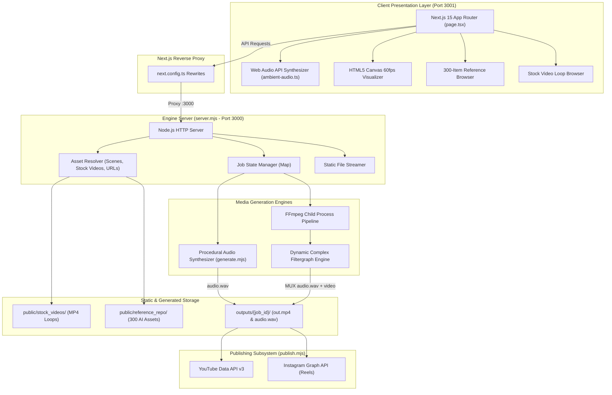

# 🏛️ System Architecture & Engineering Design

> **Document Version**: 2.0.0  
> **Date & Time**: October 13, 2026 — 15:08:05 CEST (UTC+2)  
> **Project**: Claude LoFi, Anime & Pixar Multimedia Production Studio  
> **Author**: Sudhir Thanna (`thannasudhir9`)  

---

## 1. Architectural Overview

Claude LoFi Studio is architected around an asynchronous, event-driven, decoupled multimedia pipeline. Generating high-definition video loops with synchronized procedural music requires balancing computational intensity (DSP synthesis, FFmpeg video encoding) with ultra-responsive UI interactions (real-time ambient soundscapes, live canvas audio visualizers, and instant asset browsing).



---

## 2. Dual-Server Topology & Network Architecture

The application adopts a hybrid architecture providing both bleeding-edge developer ergonomics and maximum deployment resiliency:

### 2.1 Next.js 15 Frontend Studio (`web/`, Port 3001)
- Built with **Next.js 15 App Router**, **React 19**, and **Tailwind CSS**.
- Leverages client-side Web Audio API nodes (`AudioContext`, `BiquadFilterNode`, `GainNode`, `PeriodicWave`) for zero-latency interactive audio previews before rendering.
- Connects to the backend engine via transparent reverse proxy rewrites configured in `web/next.config.ts`:
  ```typescript
  async rewrites() {
    return [
      { source: "/api/:path*", destination: "http://localhost:3000/api/:path*" },
      { source: "/outputs/:path*", destination: "http://localhost:3000/outputs/:path*" },
      { source: "/backgrounds/:path*", destination: "http://localhost:3000/backgrounds/:path*" },
      { source: "/reference_repo/:path*", destination: "http://localhost:3000/reference_repo/:path*" },
      { source: "/stock_videos/:path*", destination: "http://localhost:3000/stock_videos/:path*" },
    ];
  }
  ```

### 2.2 Core Node.js Engine Backend (`server.mjs`, Port 3000)
- Zero-dependency Node.js standard library HTTP server (`node:http`, `node:fs/promises`, `node:child_process`).
- Operates as the master orchestrator for FFmpeg subprocesses, audio synthesis jobs, and media hosting.
- Serves an embedded fallback UI (`public/index.html`) on port 3000, enabling lightweight single-binary or containerized deployments where Next.js is not needed.

---

## 3. Asynchronous Job State Machine

Video rendering is inherently non-blocking. When a user submits a generation request via `POST /api/generate`, the server allocates a unique 8-character hexadecimal identifier (`randomUUID().slice(0, 8)`), provisions an isolated workspace directory (`outputs/{job_id}/`), and registers the job in an in-memory State Machine:

```
[ PENDING ]
    │
    ▼ (Allocate job folder & validate media)
[ GENERATING_AUDIO (0% - 30%) ]
    │  - Pick musical scale & chords
    │  - Synthesize multi-oscillator waveforms
    │  - Write 16-bit PCM stereo WAV (audio.wav)
    │
    ▼ (Spawn FFmpeg child process)
[ RENDERING_VIDEO (30% - 95%) ]
    │  - Resolve background (image, stock video, or downloaded stream)
    │  - Apply style LUTs & filtergraph (Anime curves / Pixar bloom)
    │  - Seamless video looping (-stream_loop -1)
    │  - Burn animated progress bar & subtitles
    │
    ▼ (FFmpeg process exits with code 0)
[ COMPLETED (100%) ] ───► [ PUBLISHING (Optional) ]
    │
    └── (On any failure) ──► [ FAILED (Progress: 100%, Error Logged) ]
```

### Polling Mechanism
The client queries `GET /api/jobs/{id}` every 1,500ms. The response payload returns real-time progress percentages, diagnostic log strings, and the final media URLs once complete:
```json
{
  "id": "aca82b02",
  "status": "completed",
  "progress": 100,
  "step": "Rendering completed successfully",
  "videoUrl": "/outputs/aca82b02/out.mp4",
  "audioUrl": "/outputs/aca82b02/audio.wav",
  "duration": 30
}
```

---

## 4. Procedural Audio Synthesis Engine (`generate.mjs`)

The procedural audio engine creates authentic lo-fi music from pure mathematics without relying on third-party sound libraries or copyright-encumbered sample packs.

### 4.1 Musical Theory & Scale Mapping
The engine models 9 distinct emotional mood palettes, defining tempo (BPM), scale intervals, and 4-chord progressions:
- **Chilled Study** (74 BPM, C Major / A Minor): Classic nostalgic IV-V-iii-vi progression.
- **Rainy Tokyo** (68 BPM, D Minor): Melancholic minor 7th and 9th chords.
- **Cyberpunk Drift** (84 BPM, F Minor): Driving synth basslines and dark ambient pads.
- **Midnight Jazz** (70 BPM, Eb Major): Smooth ii-V-I jazz voicings with rich 9th extensions.
- **Sunset Haze** (72 BPM, G Major): Warm pentatonic arpeggios.
- **Coffee Shop** (78 BPM, Bb Major): Upbeat acoustic Rhodes and swing cadence.
- **Sleepy Rain** (60 BPM, C Minor): Slow, spacious chords designed for sleep and deep focus.
- **Ghibli Meadow** (76 BPM, F Major): Joe Hisaishi-inspired lyrical pentatonic motifs.
- **Pixar Wonder** (80 BPM, D Lydian): Dreamy raised 4th intervals and magical celeste arpeggios.

### 4.2 Waveform Synthesis & DSP Chain
For every chord and note, the engine renders 44.1kHz 16-bit stereo PCM audio using a custom DSP pipeline:
1. **Multi-Oscillator Tone Generator**: Blends a warm fundamental sine wave, a softened triangle wave, and bandlimited pulse waves for electric piano character.
2. **ADSR Envelope**: Smooth 40ms attack, gentle exponential decay, 70% sustain, and 120ms release to eliminate clicking and popping.
3. **Resonant Lowpass Filter**: Simulates warm analog cassette tape playback by cutting off high frequencies above 3,200 Hz with subtle resonance around 800 Hz.
4. **Vinyl Crackle & Dust Generator**: Random Poisson-distributed click impulses mixed with low-amplitude shaped pink noise.
5. **Tape Wow & Flutter**: Subtle low-frequency sinusoidal pitch modulation (0.3 Hz to 0.7 Hz) replicating warped analog cassette playback.
6. **WAV File Serialization**: Encodes the generated buffer directly into a canonical RIFF/WAVE header and PCM data chunk.

---

## 5. Video Composition & FFmpeg Pipeline (`server.mjs`)

The video rendering pipeline transforms static images, GIFs, and MP4 video loops into finished broadcast-ready videos using dynamic FFmpeg filtergraphs.

### 5.1 Dual Media Resolution (Image vs. Video Loop)
The engine inspects the selected scene or uploaded background:
- **If Image (`.jpg`, `.png`, `.webp`)**:
  ```bash
  ffmpeg -y -loop 1 -t {duration} -i bg.jpg -i audio.wav ...
  ```
- **If Video Loop (`.mp4`, `.mov`, `.webm`, `.gif`)**:
  ```bash
  ffmpeg -y -stream_loop -1 -i bg.mp4 -i audio.wav -t {duration} ...
  ```
  *The `-stream_loop -1` parameter causes FFmpeg to seamlessly repeat the input video stream indefinitely until the audio duration `-t {duration}` is reached.*

### 5.2 Dynamic Style Filtergraphs
To achieve distinctive aesthetic styles, custom FFmpeg filtergraphs are compiled at runtime:

#### Makoto Shinkai Anime Style
```
[bg0]hqdn3d=3:2:5:4,
eq=saturation=1.42:contrast=1.16:brightness=0.02,
unsharp=7:7:1.3:5:5:0.5,
curves=r='0/0 0.5/0.52 1/1':b='0/0 0.5/0.54 1/1'[bg]
```
- Applies high-quality 3D temporal noise reduction (`hqdn3d`).
- Boosts saturation (+42%) and contrast (+16%) for vivid sky and sunset hues.
- Applies aggressive unsharp masking to emphasize anime line art.
- Shapes RGB curves to introduce vibrant cyan blues and warm sunset magenta tones.

#### Pixar 3D Animation Style
```
[bg0]split=2[orig][bloom];
[bloom]eq=brightness=0.06:contrast=1.28:saturation=1.45,gblur=sigma=20:steps=2[bloom];
[orig][bloom]blend=all_mode=screen:all_opacity=0.45[blended];
[blended]colorbalance=rs=0.05:gs=0.02:bs=-0.03,unsharp=5:5:0.7:3:3:0.3[bg]
```
- Splits the frame into original and bloom channels.
- Applies a 20-sigma Gaussian blur (`gblur`) to the bloom channel.
- Blends the bloom back using a **screen** blend mode at 45% opacity to replicate soft Pixar studio lighting bloom.
- Enhances warm red and green shadows with cool blue undertones (`colorbalance`).

### 5.3 Overlays & Text Rendering
- **Animated Progress Bar**: Evaluated continuously via `drawbox` filter:
  ```
  drawbox=x=0:y=ih-8:w='iw*(t/{duration})':h=8:color=white@0.85:t=fill
  ```
- **Title & Subtitle Typography**: Rendered via `drawtext` with drop shadows and font resolution fallback, with comprehensive character escaping for colons and apostrophes.
- **Encoding Flags**: Output is formatted with `libx264` codec, `pix_fmt yuv420p` for 100% universal browser and mobile compatibility, and `-movflags +faststart` for instantaneous web streaming.

---

## 6. Social Media Publishing Architecture (`publish.mjs`)

The publishing module provides automated distribution to major video and social platforms:
- **YouTube Data API v3**: Performs multi-part chunked resumable upload of the MP4 file, specifying video title, auto-generated SEO tags (`#lofi`, `#anime`, `#chillbeats`), description, category `10` (Music), and privacy status (`public` or `unlisted`).
- **Instagram Graph API**: Interacts with the Facebook Graph API to create a Reels video container from a public media URL, polls container readiness, and triggers final publication.
- **Extensible Webhook Hooks**: Architecture allows hooking into TikTok for Business API and Twitter/X Media API via standardized JSON payload dispatch.

---

## 7. Storage & File Lifecycle

All rendered jobs are sandboxed under `outputs/{job_id}/`:
- `audio.wav`: Raw uncompressed procedural audio render.
- `out.mp4`: Final muxed H.264 / AAC video file.
- `metadata.json`: Full job parameters, timestamps, and generation stats.
- Cleanup policies ensure old scratch outputs can be purged while maintaining active user references.

---

## 🖥️ Studio Monitor Dual-Mode State Machine & Selection Bus

The Studio Monitor on the right side of the workspace acts as the primary visual display, operating as a deterministic finite state machine between **Live Stage** and **Rendered Video**:

```
                       ┌─────────────────────────────────────────────────────────────┐
                       │                                                             │
                       │                      INITIAL LOAD                           │
                       │                  (loadHistory without auto-set)             │
                       │                                                             │
                       └──────────────────────────────┬──────────────────────────────┘
                                                      │
                                                      ▼
                       ┌─────────────────────────────────────────────────────────────┐
                       │                       LIVE STAGE MODE                       │
                       │              (previewMode === true || result === null)      │
                       │                                                             │
                       │  - Living Backdrop: sceneImgSrc (/backgrounds/...)          │
                       │  - Real-time 60fps HTML5 Canvas Particle Engine:            │
                       │    * LoFi: Rain streaks & amber dust particles              │
                       │    * Anime: Pink cherry blossoms (sakura) & star glow       │
                       │    * Pixar: Warm fireplace embers & cozy fireflies          │
                       │    * Devotional: Floating golden river lotus diyas          │
                       │    * Cyberpunk: High-speed neon rain & cyan streaks         │
                       │    * Nature: Emerald leaves & sunlight pollen drift         │
                       │    * Simple AI: Clean geometric dots & subtle breathing     │
                       └──────────────┬──────────────────────────────▲───────────────┘
                                      │                              │
                          POST /api/generate or                      │ [✕ New Scene] or
                          Load from Vault                            │ Any Selection Click:
                                      │                              │ - Preset Chip
                                      ▼                              │ - Mood Card
                       ┌──────────────────────────────────────────┐  │ - Style Selector
                       │                   RENDERED               │  │ - Category Pill
                       │                  VIDEO MODE              │  │ - Subcategory Pill
                       │           (previewMode === false &&      │──┘ - Scene Grid Card
                       │                result !== null)          │    - Reference Drawer
                       │                                          │    - Upload Activate
                       │  - HTML5 <video> with controls & scrub   │
                       │  - ID & Metadata Banner: ID, 16:9, Res   │
                       │  - Direct MP4 & WAV Download actions     │
                       │  - YouTube & Instagram Reels publisher   │
                       │  - [▶ Watch Video / 🖼 Scene Stage] deck │
                       │  - [✕ New Scene] instant dismiss button  │
                       └──────────────────────────────────────────┘
```

### Selection Event Synchronization Invariants
To prevent video-locking bugs (such as BUG-015 where the monitor was locked to the `#b2f43a63` chair video), every visual selection interaction in `web/app/page.tsx` adheres to the following invariant:
1. `setPreviewMode(true)` is invoked immediately.
2. `setResult(null)` is invoked to unmount the rendered video tag and restore active stage canvas rendering.
3. The newly selected background (`selectedScene`) and style (`style`) are applied atomically.
4. If a video has been generated, users can click `[✕ New Scene]` in the deck header at any time to return to designing without page reload.
